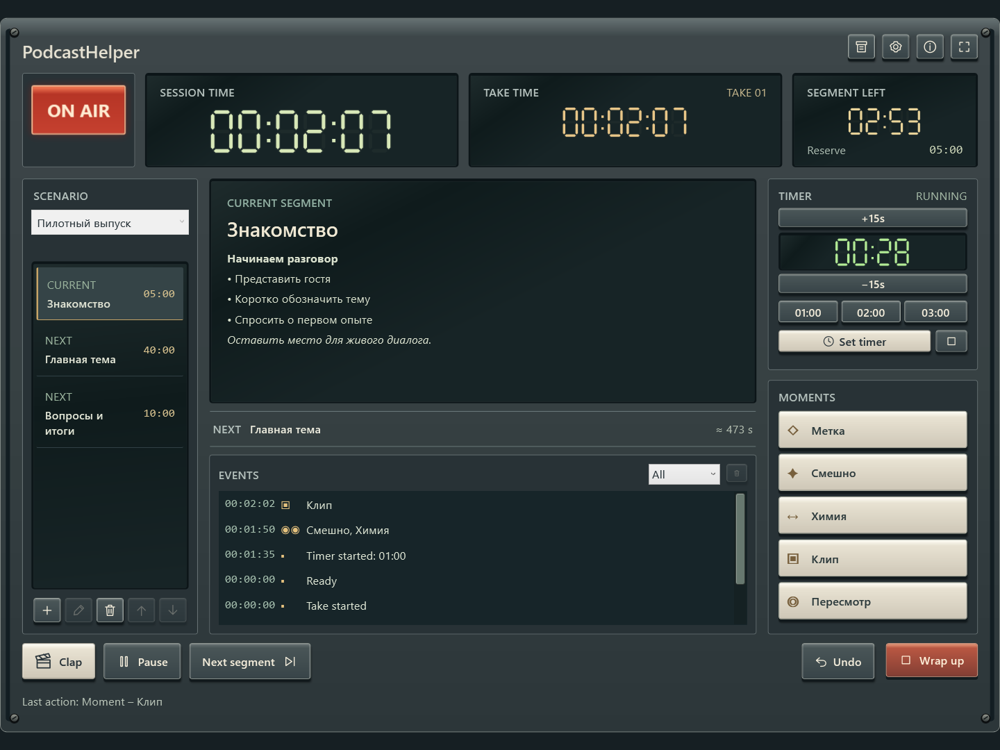
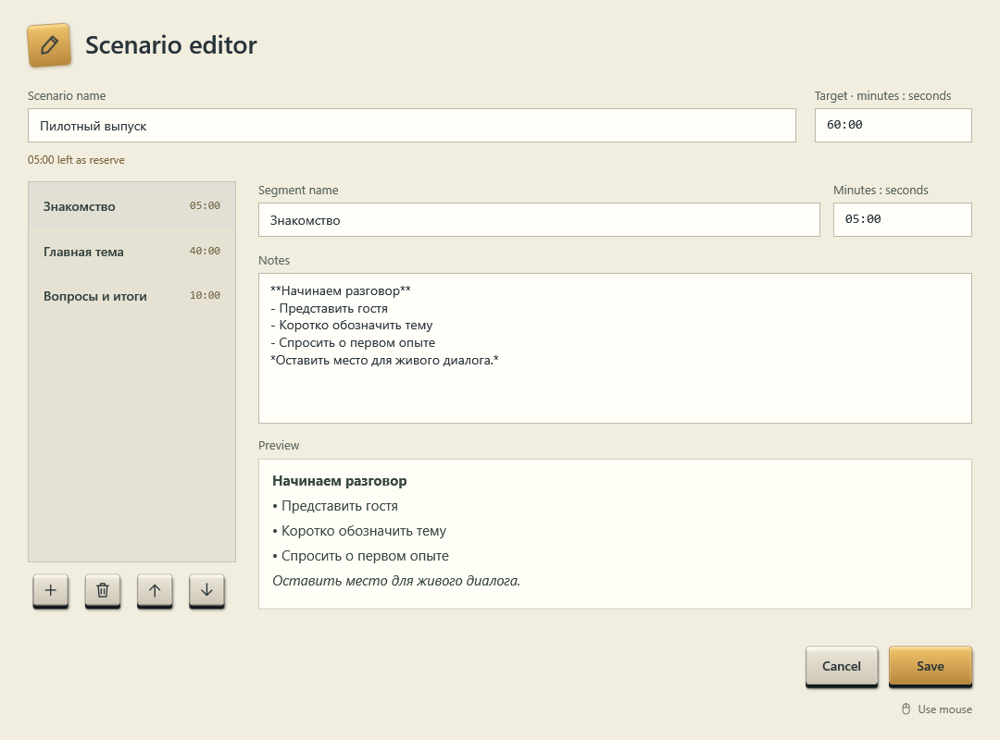
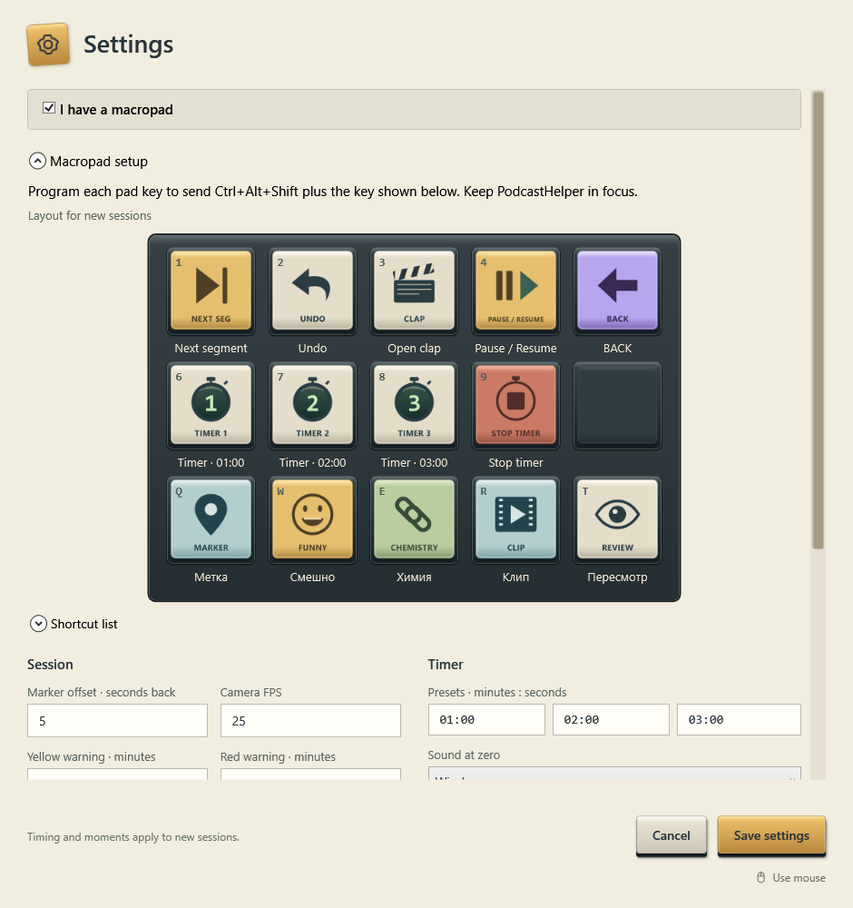

# PodcastHelper 1.0

Локальный помощник оператора подкаста для Windows: сценарий выпуска, отсчёты, хлопушки, моменты, история и экспорт. Интерфейс на английском, в стиле студийной аппаратуры 1990-х.

PodcastHelper не записывает аудио или видео и не управляет камерами. Индикатор **ON AIR** отражает состояние сессии в приложении, а не сигнал от оборудования.

[Загрузка для Windows x64](https://github.com/real-squid-kid/podcast-helper/releases) · [Сообщить о проблеме](https://github.com/real-squid-kid/podcast-helper/issues)

## Возможности

- Сценарии с сегментами, длительностями и заметками с облегчённым Markdown.
- Отдельные часы сессии и дубля, отсчёт сегмента, общий резерв и два способа сокращения будущих сегментов при перерасходе.
- Хлопушки по физическому Enter, пауза с учётом остановки записи и ручное переключение сегментов.
- Один таймер с тремя пресетами, корректировкой времени и звуком Windows или пользовательским MP3.
- Пять настраиваемых категорий моментов: Marker, Funny, Chemistry, Clip и Review. По умолчанию метка ставится на пять секунд раньше нажатия; соседние нажатия объединяются.
- Undo с возможностью вернуть отменённое через Redo в течение десяти секунд, до следующего действия с сессией.
- Автоматическое сохранение, восстановление после сбоя и история выпусков, доступная без экспорта.
- CSV и настоящий Excel 97–2003 XLS: краткая выгрузка для монтажа или полный журнал сессии.
- Управление мышью и фиксированная раскладка макропада 3×5.

## Скриншоты

Примеры с вымышленным сценарием и заметками на русском языке. Подписи интерфейса остаются английскими.

### Панель оператора

### Редактор сценария

### Настройки и макропад

## Запуск

1. Скачайте ZIP-пакет Windows x64 со страницы релизов.
2. Полностью распакуйте его в папку, в которой разрешена запись файлов.
3. Запустите `PodcastHelper.exe` из распакованной папки.

Установка .NET, права администратора и подключение к интернету для работы не требуются. Сохраняйте исполняемый файл вместе со всеми подпапками дистрибутива. Программа предназначена для Windows x64; совместимость со всеми версиями и сборками Windows отдельно не заявляется.

## Первая сессия

1. Создайте сценарий: задайте общий тайминг, добавьте сегменты, их длительности и заметки. Несовпадение суммы сегментов с общим временем показывается предупреждением и не мешает сохранению.
2. При необходимости настройте пресеты таймера, категории моментов и `I have a macropad`.
3. Нажмите **Ready to Record**. На первую хлопушку нажмите физический **Enter** — начнутся часы сессии и первого дубля.
4. Переключайте сегменты через **Next segment**. Достижение нуля само по себе не переключает сегмент.
5. Для дополнительной хлопушки нажмите **Clap**, затем Enter в момент хлопка. Часы текущего дубля продолжатся.
6. Для завершения нажмите **Wrap up** и подтвердите мышью. Next segment на последнем сегменте также завершает сессию.

При **Pause** ответьте на **Was recording stopped?**:

- **Yes** — запись была остановлена. После Resume потребуется новая хлопушка; Enter начнёт новый дубль.
- **No** — запись продолжалась. После Resume сохранится текущий дубль без обязательной хлопушки.

Во время паузы Session Time продолжает идти, а сегмент и таймер стоят. Решения в модальных окнах принимаются мышью; ввод текста в полях разрешён, Enter хлопушки остаётся исключением.

## Экспорт

Экспорт доступен на экране итогов и из истории. По умолчанию включён **Moments & claps only**: моменты, хлопушки, дубли и краткие сведения о сессии. Снимите флажок для полного журнала с событиями, каждым нажатием и изменениями сегментов. Выбор действует для CSV и XLS.

`sessionTime` момента учитывает настроенный offset. Поля `pressedSessionTime` и `pressedTakeTime` в кратком экспорте обозначают фактическое первое нажатие. Расчётный таймкод камеры основан на часах компьютера; кадровая часть всегда `:00`. Это ориентир, а не кадровая синхронизация с оборудованием.

Сохранение выпуска в истории не зависит от экспорта. Изменение исходного сценария по итогам сессии требует отдельного подтверждения. Совместимость экспорта с Premiere, Resolve и VEGAS не заявляется.

## Макропад

Включите **I have a macropad** в настройках. Каждая назначенная клавиша отправляет **Ctrl+Alt+Shift** вместе с указанной физической клавишей:

| | | | | |
|---|---|---|---|---|
| **1** Next segment | **2** Undo | **3** Open clap | **4** Pause / Resume | BACK¹ |
| **6** Timer 1 | **7** Timer 2 | **8** Timer 3 | **9** Stop timer | Пустая клавиша |
| **Q** Marker | **W** Funny | **E** Chemistry | **R** Clip | **T** Review |

¹ BACK переключает раскладку в программе самого макропада. BACK и пустая клавиша не отправляют команду PodcastHelper. Подписи и значки квадратных кнопок поставляются в папке `buttons`.

Команды работают только при фокусе на главном окне, вне редактируемых полей и модальных диалогов. Хлопушка фиксируется отдельным физическим Enter. Wrap up доступна только мышью.

## Данные и обновление

Для резервной копии закройте PodcastHelper и скопируйте всю переносимую папку целиком. Перед обновлением сохраните такую копию; переносите пользовательские данные в новую версию, не заменяя новые библиотеки старыми. При ошибке сохранения восстановите доступ к папке и свободное место на диске, следуя сообщению приложения.

## Лицензия

MIT, © 2026 Caspian. Полный текст — в [LICENSE](LICENSE), уведомления о поставляемых компонентах — в [THIRD_PARTY_NOTICES.md](THIRD_PARTY_NOTICES.md).

Made with love by Caspian.
